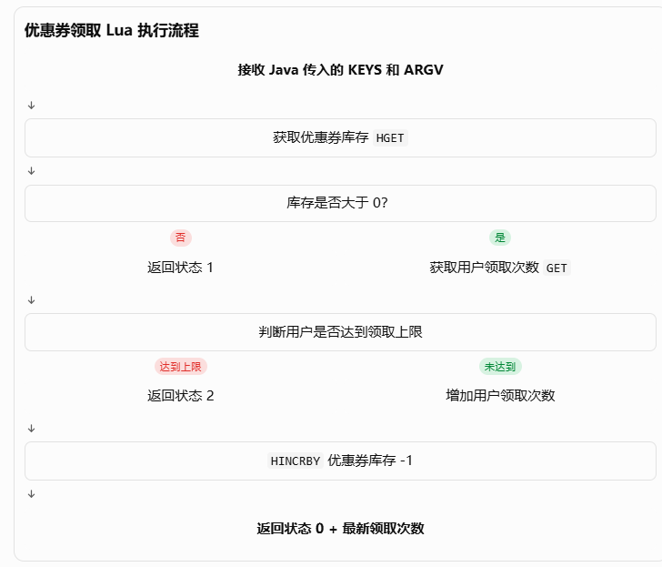

# Redis Lua 脚本：从基础语法到 Java 工程实践

## 一、为什么 Java 后端开发需要了解 Lua？

在 Java 后端开发中，我们经常会使用 Redis 完成缓存查询、库存扣减、分布式锁、限流等操作。

对于一些简单的 Redis 操作，我们可以直接通过 Spring Data Redis 提供的 API 完成。

例如：

```
stringRedisTemplate.opsForValue().get("user:1001");
stringRedisTemplate.opsForValue().increment("user:1001");
stringRedisTemplate.opsForHash().get("coupon:1001", "stock");
```

但是，当一个业务操作需要执行多个 Redis 命令时，就可能出现并发问题。

假设现在有一个优惠券领取业务，需要完成以下操作：

1. **查询优惠券库存。**
2. **判断库存是否充足。**
3. 查询用户已经领取的次数。
4. 判断用户是否达到领取上限。
5. 增加用户领取次数。
6. **扣减优惠券库存。**

如果我们直接在 Java 中逐条执行 Redis 命令，这些操作之间可能被其他请求打断。

例如，两个请求同时查询到库存为 1，随后都执行扣减，就可能导致超卖。

为了解决这类问题，我们可以使用 Redis Lua 脚本，将多个 Redis 操作封装在一个脚本中执行。

**Lua 是一种轻量级脚本语言，Redis 支持在服务端执行 Lua 脚本，从而将多个 Redis 操作组织成一个原子执行单元。**

对于 Java 后端开发者来说，不需要掌握 Lua 的全部语法，只需要掌握 Redis Lua 开发所需要的基础知识即可。

## 二、Lua 基础语法

先来看一下 Redis Lua 脚本中最常见的几种语法。

### 1. 注释

Lua 使用 `--` 表示单行注释。

```
-- 获取优惠券库存
local stock = 100
```

### 2. 定义变量：local

Lua 使用 `local` 定义局部变量。

```
local stock = 100
local userCouponCount = 2
```

这里与 Java 有一个比较明显的区别：Lua 不需要显式声明变量类型。

例如：

```
local stock = 100
local name = "coupon"
local flag = true
```

Lua 会根据赋值内容自动处理变量类型。

### 3. 定义函数：function

Lua 可以通过 `function` 定义函数。

```
local function add(a, b)
    return a + b
end

local result = add(10, 20)
```

这里的 `local function` 表示定义一个局部函数，只能在当前作用域内使用。

在优惠券领取脚本中，作者就定义了一个函数，用来组合业务状态和用户领取次数。

```
local function combineFields(firstField, secondField)

    local SECOND_FIELD_BITS = 14

    local shiftedFirstField =
            firstField * (2 ^ SECOND_FIELD_BITS)

    return shiftedFirstField + secondField
end
```

### 4. 条件判断：if then end

Lua 使用 `if then end` 实现条件判断。

```
local stock = 10

if stock <= 0 then
    return 1
end
```

如果库存小于等于 0，就返回状态码 1。

如果需要多个分支，可以使用 `elseif` 和 `else`：

```
if stock <= 0 then
    return 1
elseif stock < 10 then
    return 2
else
    return 0
end
```

### 5. nil：表示不存在的值

Lua 中使用 `nil` 表示不存在的值。

例如：

```
local userCouponCount = nil

if userCouponCount == nil then
    userCouponCount = 0
end
```

在 Redis Lua 脚本中，这个知识点尤其常见。

当 Redis 中某个 Key 不存在时，执行 `GET` 会返回空值，在 Lua 中通常表现为 `false`，经过 `tonumber()` 转换后则得到 `nil`。

因此，我们经常需要判断：

```
if userCouponCount == nil then
    userCouponCount = 0
end
```

### 6. 类型转换：tonumber()

Redis 返回的数据需要根据业务需要进行类型转换。

Lua 使用 `tonumber()` 将字符串转换成数字。

```
local stock = tonumber("100")
local count = tonumber("5")

local result = stock - count
```

如果传入的内容不能转换为数字，或者参数为 `nil`，则会得到 `nil`。

因此，在涉及数值计算时，通常需要使用 `tonumber()`。

### 7. 幂运算：^

Lua 使用 `^` 表示幂运算。

```
local result = 2 ^ 14
```

结果为：

```
16384
```

这在后面的业务返回值编码中会用到。

## 三、Lua 如何操作 Redis？

前面介绍的是 Lua 自身的语法。

但 Redis Lua 的核心价值在于：它可以通过 Redis 提供的接口，直接调用 Redis 命令。

### 1. redis.call()

Redis 提供了 `redis.call()`，用于在 Lua 脚本中执行 Redis 命令。

例如：

```
redis.call('GET', 'user:1001')
```

相当于在 Redis 命令行中执行：

```
GET user:1001
```

再看一个 Hash 操作：

```
redis.call('HGET', 'coupon:1001', 'stock')
```

相当于：

```
HGET coupon:1001 stock
```

因此，我们可以把 `redis.call()` 理解为 Lua 与 Redis 之间的操作接口。

### 2. redis.call() 与 redis.pcall() 的区别

Redis 还提供了 `redis.pcall()`。

两者的区别主要在于错误处理：

| 方法            | 作用                                                 |
| --------------- | ---------------------------------------------------- |
| `redis.call()`  | Redis 命令执行错误时，抛出脚本错误                   |
| `redis.pcall()` | Redis 命令执行错误时，将错误作为返回结果交给脚本处理 |

例如：

```
local result = redis.pcall('HGET', 'coupon:1001', 'stock')

if type(result) == 'table' and result.err then
    return -1
end
```

一般业务脚本使用 `redis.call()` 就足够了；如果需要在脚本中自行处理某条 Redis 命令的错误，可以考虑 `redis.pcall()`。

### 3. Redis Lua 中常见的 Redis 命令

在优惠券领取场景中，我们会用到以下命令：

| Redis 命令 | 作用                           | 数据结构 |
| ---------- | ------------------------------ | -------- |
| GET        | 获取 Key 对应的值              | String   |
| SET        | 设置 Key 对应的值              | String   |
| INCR       | 将数值加一                     | String   |
| HGET       | 获取 Hash 中指定字段           | Hash     |
| HINCRBY    | 对 Hash 中指定数值字段进行增减 | Hash     |
| EXPIRE     | 设置 Key 的相对过期时间        | 通用     |
| EXPIREAT   | 设置 Key 的绝对过期时间        | 通用     |

例如：

```
-- 获取库存
local stock = redis.call('HGET', KEYS[1], 'stock')

-- 获取用户领取次数
local count = redis.call('GET', KEYS[2])

-- 用户领取次数加一
redis.call('INCR', KEYS[2])

-- 优惠券库存减一
redis.call('HINCRBY', KEYS[1], 'stock', -1)
```

可以看到，Redis Lua 并没有创造新的 Redis 数据操作方式，而是将我们熟悉的 Redis 命令组合到了一个脚本中。

## 四、KEYS 和 ARGV：Java 如何向 Lua 传递参数？

这是 Redis Lua 开发中非常重要的一个约定。

Redis 执行 Lua 脚本时，可以通过两个特殊数组接收外部参数：

- `KEYS`：存放 Redis Key。
- `ARGV`：存放普通业务参数。

例如：

```
-- KEYS[1]：优惠券库存 Key
-- KEYS[2]：用户领取次数 Key

-- ARGV[1]：优惠券有效期
-- ARGV[2]：用户领取上限
```

在 Lua 中可以这样使用：

```
local stock = redis.call(
    'HGET',
    KEYS[1],
    'stock'
)

local limit = tonumber(ARGV[2])
```

这里有几个细节需要注意：

**第一，Lua 数组从 1 开始索引。**

与 Java 数组从 0 开始不同：

```
KEYS[1]
KEYS[2]
ARGV[1]
ARGV[2]
```

**第二，KEYS 和 ARGV 的职责不同。**

KEYS 用于传递 Redis Key，ARGV 用于传递业务参数。

这样做有利于脚本管理和 Redis Cluster 环境下的 Key 路由。

**第三，ARGV 中的参数通常需要进行类型转换。**

例如：

```
local limit = tonumber(ARGV[2])
```

因为通过 Redis 脚本参数传入的普通业务参数通常以字符串形式提供。

## 五、为什么 Redis Lua 可以保证原子性？

这是学习 Redis Lua 最重要的一个知识点。

### 1. 先看一个普通 Java 操作的问题

假设优惠券库存只有 1 张，现在有两个用户同时领取。

如果 Java 代码采用下面的方式：

```
// 查询库存
Long stock = stringRedisTemplate
        .opsForHash()
        .get("coupon:1001", "stock");

// 判断库存
if (stock > 0) {

    // 扣减库存
    stringRedisTemplate
            .opsForHash()
            .increment("coupon:1001", "stock", -1);
}
```

可能发生这样的情况：

```
请求 A：查询库存，结果为 1
请求 B：查询库存，结果为 1

请求 A：判断库存充足
请求 B：判断库存充足

请求 A：扣减库存，变为 0
请求 B：扣减库存，变为 -1
```

这就是典型的并发超卖问题。

问题出在哪里？

因为查询库存和扣减库存是两个独立的 Redis 操作，中间可能被其他请求打断。

### 2. 使用 Lua 将多个操作合并

我们可以将检查库存和扣减库存放到同一个 Lua 脚本中：

```lua
local stock = tonumber(
    redis.call('HGET', KEYS[1], 'stock')
)

if stock <= 0 then
    return 1
end

redis.call('HINCRBY', KEYS[1], 'stock', -1)

return 0


--这里返回值是自定义的“状态码”
```

当请求 A 执行 Lua 脚本时，Redis 会先检查库存，再完成扣减。

在整个脚本执行期间，其他客户端的命令不会插入执行过程。

因此：

```
请求 A：
执行 Lua
  ↓
检查库存：1
  ↓
扣减库存：0
  ↓
脚本结束

请求 B：
等待请求 A 执行完成
  ↓
执行 Lua
  ↓
检查库存：0
  ↓
返回库存不足
```

这样就避免了两个请求同时基于旧库存进行扣减。

### 3. Lua 原子性需要注意什么？

这里需要区分两个概念：

**原子执行不等于事务回滚。**

Redis Lua 脚本具有原子执行特性：执行期间不会被其他客户端命令打断。

但是，如果脚本执行到一半发生运行时错误，之前已经执行成功的 Redis 写操作不会自动回滚。

例如：

```
redis.call('INCR', KEYS[1])

-- 假设这里发生错误
redis.call('UNKNOWN_COMMAND')
```

第一条 `INCR` 已经执行成功，即使后续命令报错，也不会自动恢复原值。

因此，编写 Lua 脚本时应当：

1. 尽量先完成参数校验。
2. 尽量先完成业务条件检查。
3. 确认数据类型和数值合法后再执行写操作。
4. 避免在写操作之后执行可能产生错误的命令。

**另外，Lua 原子性只覆盖 Redis 内部的执行，不代表 Redis 与 MySQL 之间也具备原子性。**

## 六、实战：优惠券领取 Lua 脚本

理解了基础语法和 Redis 命令之后，我们回到 oneCoupon 项目。

这个脚本的业务目标是：

**用户领取优惠券时，需要同时检查优惠券库存和用户领取次数限制，只有满足条件才能扣减库存并增加用户领取次数。**

### 1. 脚本参数

```
-- KEYS[1]: 优惠券库存键
-- KEYS[2]: 用户领取记录键

-- ARGV[1]: 优惠券有效期结束时间
-- ARGV[2]: 用户领取上限
```

其中：

- KEYS[1] 对应优惠券模板的 Hash Key。
- KEYS[2] 对应用户针对该优惠券模板的领取次数 Key。

### 2. 获取优惠券库存

```
local stock = tonumber(
    redis.call('HGET', KEYS[1], 'stock')
)

if stock <= 0 then
    return combineFields(1, 0)
end
```

首先通过 `HGET` 获取优惠券模板 Hash 中的 `stock` 字段。

然后使用 `tonumber()` 转换为数字。

如果库存小于等于 0，直接返回库存不足状态。

这里有一个前提：库存 Key 必须存在，而且 stock 必须是合法数字，否则 `stock <= 0` 可能产生运行时错误。

### 3. 获取用户领取次数

```
local userCouponCount = tonumber(
    redis.call('GET', KEYS[2])
)

if userCouponCount == nil then
    userCouponCount = 0
end
```

如果用户之前没有领取过优惠券，对应的 Redis Key 就可能不存在。

此时 `GET` 返回空值，经过 `tonumber()` 转换后得到 `nil`。

因此，代码将其初始化为 0。

### 4. 判断用户是否达到领取上限

```
if userCouponCount >= tonumber(ARGV[2]) then
    return combineFields(2, userCouponCount)
end
```

这里通过 `ARGV[2]` 获取用户领取上限。

如果用户当前领取次数已经达到上限，就返回状态码 2，不再执行后面的扣减操作。

### 5. 增加用户领取次数

```
if userCouponCount == 0 then

    redis.call('SET', KEYS[2], 1)

    redis.call('EXPIRE', KEYS[2], ARGV[1])

else

    redis.call('INCR', KEYS[2])

end
```

这里分成两种情况。

**第一次领取：**

用户之前没有领取过优惠券，需要先使用 `SET` 创建领取次数 Key，再设置过期时间。

**后续领取：**

用户已经有领取记录，直接使用 `INCR` 将领取次数加一即可。

因为第一次领取时已经设置了过期时间，所以后续递增不需要重新设置 TTL。

这里需要特别注意一个时间单位问题：

`EXPIRE` 接收的是相对过期秒数，而不是 Unix 时间戳。

如果 `ARGV[1]` 实际上传入的是 Unix 秒级时间戳，就应该使用：

```
redis.call('EXPIREAT', KEYS[2], ARGV[1])
```

如果传入的是毫秒级时间戳，则应考虑使用 `PEXPIREAT`。

因此，阅读这段源码时，还需要回到 Java 调用方核对 `ARGV[1]` 的实际值，不能只依赖参数注释。

### 6. 扣减优惠券库存

```
redis.call(
    'HINCRBY',
    KEYS[1],
    'stock',
    -1
)
```

通过 `HINCRBY` 将优惠券模板 Hash 中的 stock 字段减一。

至此，用户领取次数增加，优惠券库存减少。

因为这些操作都在同一个 Lua 脚本中执行，所以其他请求不会在中间插入操作。

### 7. 返回领取结果

```
return combineFields(0, userCouponCount + 1)
```

如果前面的检查全部通过，就返回成功状态以及本次领取后的次数。

这里就涉及一个值得单独理解的工程技巧：如何将多个业务结果编码到一个返回值中。

## 七、工程技巧：通过位运算组合业务返回值

oneCoupon 没有直接返回两个独立字段，而是通过一个 Long 数值，同时传递业务状态和用户领取次数。

### 1. Lua 端编码

```
local function combineFields(firstField, secondField)

    local SECOND_FIELD_BITS = 14

    local shiftedFirstField =
            firstField * (2 ^ SECOND_FIELD_BITS)

    return shiftedFirstField + secondField
end
```

这里使用 14 位保存第二个字段。

因为：

[
2^{14}=16384
]

而用户领取次数最大为 9999，小于 16384，所以低 14 位可以容纳领取次数。

编码公式为：

[
result=status\times 2^{14}+count
]

其中：

- status：业务执行状态。
- count：用户领取次数。

例如：

| 状态        | 领取次数 | 编码结果 |
| ----------- | -------- | -------- |
| 0：成功     | 1        | 16385    |
| 0：成功     | 2        | 16386    |
| 1：库存不足 | 0        | 16384    |
| 2：超过上限 | 3        | 32771    |

### 2. Java 端解码

Java 通过位运算还原两个字段：

```
long status = result >> 14;

long receiveCount = result & 0x3FFF;
```

其中：

- `>> 14`：右移 14 位，获取业务状态。
- `& 0x3FFF`：通过掩码保留低 14 位，获取领取次数。

这里的 `0x3FFF` 是十六进制数，转换为二进制后，低 14 位全部为 1。

因此可以提取出领取次数。

### 3. 为什么要这样设计？

主要目的是将多个业务结果封装到一个数值返回，减少返回值的组织成本。

不过，这种方式也有一定的约束：

1. 第二个字段必须在 14 位能够表示的范围内。
2. 状态码必须能够通过剩余位数表示。
3. Java 和 Lua 两端必须严格遵守相同的编码协议。

对于简单的业务场景，这是一种可行的设计；如果返回字段越来越多，也可以考虑使用结构化结果。

## 八、Java 如何调用 Redis Lua 脚本？

前面主要介绍 Lua 脚本内部的执行逻辑。

那么 Java 如何将脚本交给 Redis 执行？

在 Spring Boot 项目中，通常可以通过 Spring Data Redis 提供的 `StringRedisTemplate.execute()` 实现。

例如：

```java
DefaultRedisScript<Long> redisScript =
        new DefaultRedisScript<>();

redisScript.setLocation(
        new ClassPathResource(
                "lua/stock_decrement_and_save_user_receive.lua"
        )
);

redisScript.setResultType(Long.class);

Long result = stringRedisTemplate.execute(
        redisScript,

        Arrays.asList(
                couponStockKey,
                userCouponKey
        ),

        endTime,
        receiveLimit
);
```

这里涉及几个重要知识点。

### 1. DefaultRedisScript

```
DefaultRedisScript<Long> redisScript =
        new DefaultRedisScript<>();
```

它是 Spring Data Redis 提供的脚本封装对象。

其中 `Long` 表示预期的脚本返回类型。

### 2. setLocation()

```
redisScript.setLocation(
        new ClassPathResource(
                "lua/stock_decrement_and_save_user_receive.lua"
        )
);
```

表示从项目的 classpath 中加载 Lua 脚本文件。

这样做的好处是：

- Java 业务代码和 Lua 脚本分离。
- 脚本可以独立维护。
- 不需要把很长的 Lua 字符串写在 Java 代码中。

### 3. setResultType()

```
redisScript.setResultType(Long.class);
```

告诉 Spring Data Redis，预期将脚本返回值转换成 Long 类型。

### 4. execute()

```
stringRedisTemplate.execute(
        redisScript,
        keys,
        args
);
```

这是最核心的调用方法。

它主要接收：

| 参数        | 作用                               |
| ----------- | ---------------------------------- |
| redisScript | 要执行的 Lua 脚本                  |
| keys        | Redis Key 列表，对应 Lua 中的 KEYS |
| args        | 普通业务参数，对应 Lua 中的 ARGV   |

因此，整个执行过程可以理解为：

```
Java 业务代码
      |
      v
组织 Redis Key 和业务参数
      |
      v
StringRedisTemplate.execute()
      |
      v
Redis 接收 Lua 脚本
      |
      v
执行 redis.call()
      |
      v
返回 Long 结果
      |
      v
Java 解析业务状态和领取次数
```



需要注意，在 Redis Cluster 环境下，一个 Lua 脚本访问的多个 Key 必须位于同一个哈希槽。实际设计 Key 时，可以使用相同的 Hash Tag，例如：

```
coupon:{1001}:stock
coupon:{1001}:user:2001
```

这样两个 Key 都会根据 `{1001}` 计算哈希槽。

## 九、总结

Lua 在 Redis 中的主要价值，是将多个 Redis 操作组织成一个原子执行单元，从而解决多个独立 Redis 命令之间可能出现的并发竞争问题。

对于 Java 后端开发者，我们需要掌握的主要是三个方面：

**第一，Lua 基础语法。**

掌握 `local`、`function`、`if`、`return`、`nil`、`tonumber()` 等常用语法，能够阅读和理解脚本。

**第二，Redis 命令调用。**

理解 `redis.call()`、`KEYS`、`ARGV`，以及 GET、SET、HGET、INCR、HINCRBY、EXPIRE 等常用 Redis 命令。

**第三，工程集成与并发控制。**

理解 Redis Lua 的原子执行特性，掌握 Java 如何通过 `DefaultRedisScript` 和 `StringRedisTemplate.execute()` 调用脚本，以及如何处理脚本返回结果。

通过 oneCoupon 的优惠券领取场景，我们可以看到 Lua 并不是一个孤立的技术点，而是 Redis 高并发业务设计中的重要工具。

当一个业务需要同时完成库存检查、领取次数校验和库存扣减时，Lua 可以将这些操作组织在一起，避免多个请求之间的执行交错。

当然，Lua 只能保证 Redis 内部操作的原子执行。后续还需要结合 MySQL 事务、消息队列和补偿机制，解决跨系统的数据一致性问题。

**对于 Java 后端开发者来说，学习 Redis Lua 的目标不是成为 Lua 开发者，而是能够根据业务需求编写、阅读和维护 Redis 脚本，理解它在高并发场景下解决了什么问题。**
