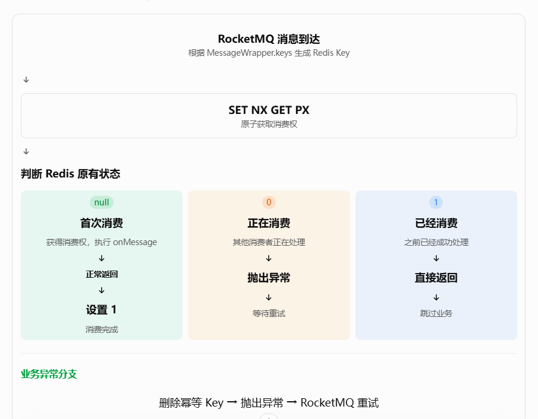

 自定义注解：@NoMQDuplicateConsume，它是一个接口： 在消费类上会使用它： @NoMQDuplicateConsume(        keyPrefix = "user-coupon-redeem:",        key = "#messageWrapper.keys",        keyTimeout = 600 ) 还会自定义 IdempotentConfiguration，这是个配置类，它的作用是让spring去管理我们的切面对象NoMQDuplicateConsumeAspect，让他变成bean;在其中还注入了 `StringRedisTemplate`切面就具备了操作 Redis 的能力。 关于NoMQDuplicateConsumeAspect，这是我们自定义的一个组件， 里面有两个方法： public Object noMQRepeatConsume(ProceedingJoinPoint joinPoint) throws Throwable public static NoMQDuplicateConsume getNoMQDuplicateConsumeAnnotation(ProceedingJoinPoint joinPoint) throws NoSuchMethodException 


# RocketMQ 入门与实战：从消息生产、消费到消费幂等

## 一、为什么需要消息队列？

在传统的同步业务处理中，一个 HTTP 请求通常需要完成所有业务操作之后才能返回响应。

例如，用户领取优惠券：

```
用户发起领取请求
       ↓
Redis 预扣减库存
       ↓
MySQL 扣减库存
       ↓
插入用户优惠券记录
       ↓
更新 Redis 用户优惠券集合
       ↓
发送优惠券到期消息
       ↓
返回领取结果
```

这种方式的优点是业务流程直观，开发人员可以按照顺序组织代码。

但随着业务复杂度增加，会出现两个问题。

**1. 请求响应时间较长**

假设数据库操作、缓存更新、消息发送等环节都需要耗费一定时间，那么这些操作的耗时就会累积到当前 HTTP 请求中。

用户必须等待所有操作完成才能得到响应。

**2. 业务模块之间耦合较强**

假设用户领取优惠券之后，还需要执行积分增加、优惠券到期提醒、营销统计等操作。

如果全部直接写在领取接口中，那么领取业务就需要依赖越来越多的其他模块。

这会导致业务逻辑越来越复杂，也增加了模块之间的耦合。

为了解决这些问题，可以引入消息队列。

### 1. 什么是消息队列？

消息队列（Message Queue，MQ）是一种用于消息传递的中间件。

它允许生产者将消息发送到消息队列，再由消费者从消息队列中获取消息并执行相应的业务处理。

最基本的结构：

```
Producer（生产者）
       ↓
   Message
       ↓
Message Queue（消息队列）
       ↓
Consumer（消费者）
```

生产者负责发送消息，消费者负责处理消息。

双方不需要直接调用对方的业务方法，而是通过消息进行通信。

### 2. 消息队列解决了什么问题？

| 能力     | 作用                                 | 业务价值           |
| -------- | ------------------------------------ | ------------------ |
| 异步处理 | 将部分业务交给消费者执行             | 缩短请求处理时间   |
| 解耦     | 生产者与消费者通过消息通信           | 降低模块之间的依赖 |
| 削峰填谷 | 消息暂存在队列中，由消费者按能力处理 | 缓解瞬时流量压力   |
| 消息重试 | 消费失败时按照配置进行重新投递       | 提高业务处理可靠性 |

需要注意，消息队列并不是让业务操作凭空消失，而是将部分工作从当前请求线程转移到消息消费者。

因此，异步处理并不意味着整个业务一定更快，而是让用户请求不必等待所有后续业务操作完成。

## 二、RocketMQ 是什么？

RocketMQ 是 Apache 开源的分布式消息和流处理平台，常用于企业级业务系统中的异步通信、消息解耦和流量削峰。

在 Java 项目中，可以通过 RocketMQ 提供的客户端与消息服务进行交互。

### 1. RocketMQ 的核心角色

| 角色           | 职责                                       |
| -------------- | ------------------------------------------ |
| Producer       | 消息生产者，负责发送消息                   |
| Consumer       | 消息消费者，负责接收和处理消息             |
| NameServer     | 提供路由信息，帮助客户端发现 Broker        |
| Broker         | 消息服务器，负责接收、存储和投递消息       |
| Topic          | 消息主题，用于对消息进行分类               |
| Consumer Group | 消费者组，用于组织具有相同消费逻辑的消费者 |

可以把它们理解成：

- Producer：负责发送消息。
- Broker：负责接收和保存消息。
- Topic：告诉系统这条消息属于什么业务。
- Consumer：负责处理消息。
- Consumer Group：组织一组具有相同消费职责的消费者。

### 2. Topic、Tag 和 Message Key

这三个概念在实际开发中非常常见。

**Topic：消息主题**

Topic 用于区分不同业务类型的消息。

例如：

```
coupon-redeem-topic
coupon-expire-topic
order-pay-topic
```

优惠券领取消息和优惠券到期消息可以使用不同的 Topic。

**Tag：消息标签**

Tag 可以在同一个 Topic 内进一步区分消息类型，方便消费者进行消息过滤。

例如：

```
Topic：coupon-topic

Tag：
  redeem
  expire
  cancel
```

**Message Key：消息业务标识**

Key 用于标识消息，方便根据业务标识检索和排查消息。

例如：

```
Message Key：
  6b1a8e7c-xxxx-xxxx-xxxx
```

需要注意，Message Key 本身并不自动提供消息幂等能力。真正的消费幂等还需要消费者实现去重机制。

## 三、OneCoupon 中的 RocketMQ 使用场景

我们以用户领取优惠券为例。

前面已经学习过 Redis Lua 预扣减库存。

当用户通过 Lua 脚本完成预扣减，并且返回成功状态后，项目提供了两种后续处理方式：

- 同步领取：直接执行数据库操作。
- 异步领取：发送 RocketMQ 消息，由消费者执行数据库操作。

本篇重点研究第二种方式。

## 1. 整体业务流程

```
用户发起领取请求
       ↓
查询优惠券模板
       ↓
检查领取时间和领取规则
       ↓
Redis Lua 原子预扣减
       ↓
解析 Lua 返回值
       ↓
判断是否领取成功
       ↓
构建 UserCouponRedeemEvent
       ↓
UserCouponRedeemProducer
       ↓
发送 RocketMQ 消息
       ↓
Broker 接收消息
       ↓
UserCouponRedeemConsumer
       ↓
MySQL 扣减库存
       ↓
插入用户优惠券记录
       ↓
更新 Redis ZSet
       ↓
发送优惠券到期延迟消息
```

这里需要明确：

Redis Lua 负责预扣减库存和领取次数，RocketMQ 负责将后续数据库处理交给消费者执行。

两者承担的是不同的职责。

## 2、消息生产者：Producer

### AbstractCommonSendProduceTemplate

父类规定了固定发送流程，但把消息差异交给子类：

```java
public abstract class AbstractCommonSendProduceTemplate<T> {

    private final RocketMQTemplate rocketMQTemplate;

    protected abstract BaseSendExtendDTO
            buildBaseSendExtendParam(T event);

    protected abstract Message<?>
            buildMessage(
                    T event,
                    BaseSendExtendDTO requestParam
            );

    public SendResult sendMessage(T event) {
        // 固定发送流程
    }
}
```

#### sendMessage

参数：messageSendEvent，类型是T
返回值：SendResult RocketMQ 发送结果，包含发送状态（SEND_OK 等）、消息 ID、队列信息等

```java
实现思路
1、构建发送参数
BaseSendExtendDTO baseSendExtendDTO = buildBaseSendExtendParam(messageSendEvent);
调用子类实现的抽象方法，获取这条消息的"路由信息"——Topic 名称、Tag、超时时间、消息 Key 等。
2、构建投递目标地址
StringBuilder destinationBuilder = StrUtil.builder().append(baseSendExtendDTO.getTopic());
if (StrUtil.isNotBlank(baseSendExtendDTO.getTag())) {
    destinationBuilder.append(":").append(baseSendExtendDTO.getTag());
}
RocketMQ 的 Topic 目标地址格式是 topicName:tag。这里把 Topic 和 Tag 拼起来，形成最终的消息投递目的地。如果没设 Tag，就只用 Topic。
3、根据是否有延迟时间，走两条发送路径

if (baseSendExtendDTO.getDelayTime() != null) {
    // 延迟消息路径
    sendResult = rocketMQTemplate.syncSendDeliverTimeMills(...);
} else {
    // 普通消息路径
    sendResult = rocketMQTemplate.syncSend(...);
}
延迟消息：调 syncSendDeliverTimeMills，传入延迟时间（毫秒），RocketMQ 会在指定时间后才把消息投递给消费者。常用于"优惠券到期清理"这类场景。
普通消息：调 syncSend，传入超时时间，立即投递。

public SendResult sendMessage(T messageSendEvent) {
     
    }
```

###  UserCouponRedeemProducer

在 OneCoupon 中，优惠券领取消息的生产者是：

这里有一个比较重要的设计：

**生产者没有直接编写所有发送逻辑，而是继承了项目封装的公共发送模板。**

 为什么继承 `AbstractCommonSendProduceTemplate`？`extends AbstractCommonSendProduceTemplate<UserCouponRedeemEvent>`

这是一种模板方法设计思路。项目将不同消息生产者共有的发送流程封装到父类中，而具体生产者只需要提供自己的消息参数和消息构建逻辑

**这样，其他业务生产者也可以继承同一个父类，只需要实现各自的消息构建逻辑。**

这种设计的好处是减少重复代码，让消息发送规范集中管理。

不过，真正的发送方式、发送结果处理和异常处理，需要结合父类 `AbstractCommonSendProduceTemplate` 的实现才能确认。

```java
@Component
public class UserCouponRedeemProducer
        extends AbstractCommonSendProduceTemplate<UserCouponRedeemEvent> {

    private final ConfigurableEnvironment environment;

    public UserCouponRedeemProducer(
            @Autowired RocketMQTemplate rocketMQTemplate,
            @Autowired ConfigurableEnvironment environment) {

        super(rocketMQTemplate);
        this.environment = environment;
    }

    @Override
    protected BaseSendExtendDTO buildBaseSendExtendParam(
           xxx
    }

    @Override
    protected Message<?> buildMessage(
       xxxx
    }
}
```

#### buildBaseSendExtendParam

负责构建消息发送所需要的公共参数。

参数：messageSendEvent	 UserCouponRedeemEvent
返回值：BaseSendExtendDTO

```
实现思路：
通过 BaseSendExtendDTO.builder() 链式调用，逐项填充四个关键字段：
① eventName("用户兑换优惠券")
② keys(UUID.randomUUID().toString())
③ topic(environment.resolvePlaceholders(...))
从配置中解析 Topic 名称。
④ sentTimeout(2000L)


@Override
    protected BaseSendExtendDTO buildBaseSendExtendParam(
            UserCouponRedeemEvent messageSendEvent) {

        return BaseSendExtendDTO.builder()
                .eventName("用户兑换优惠券")
                .keys(UUID.randomUUID().toString())
                .topic(environment.resolvePlaceholders(
                        EngineRockerMQConstant.COUPON_TEMPLATE_REDEEM_TOPIC_KEY
                ))
                .sentTimeout(2000L)
                .build();
    }
```

####  buildMessage构建实际消息

 1、作用：把业务事件对象 `UserCouponRedeemEvent` 包装成 RocketMQ 能够识别和发送的 `Message<?>` 对象。它负责“信封里的内容”。

2、参数：

messageSendEvent UserCouponRedeemEvent

requestParam BaseSendExtendDTO 上一步 buildBaseSendExtendParam 返回的发送参数，包含 Keys、Tag 等

3、返回值

 `Message<?>`：RocketMQ 消息对象，包含消息体（Payload）和消息头（Headers）。

```java
1、Keys 兜底校验
String keys = StrUtil.isEmpty(requestParam.getKeys())
        ? UUID.randomUUID().toString()
        : requestParam.getKeys();
虽然上一步 buildBaseSendExtendParam 已经生成了 UUID 作为 Keys，但这里还是做了一次防御性检查——万一上游没传或传了空字符串，就再生成一个 UUID。确保每条消息一定有 Key。
2）消息体包装
.withPayload(new MessageWrapper(keys, messageSendEvent))
没有直接把 UserCouponRedeemEvent 塞进消息体，而是套了一层 MessageWrapper
3）设置 RocketMQ 消息头
.setHeader(MessageConst.PROPERTY_KEYS, keys)
.setHeader(MessageConst.PROPERTY_TAGS, requestParam.getTag())
PROPERTY_KEYS：设置 RocketMQ 消息的 Key
PROPERTY_TAGS：设置消息的 Tag
最后 .build() 生成不可变的 Message 对象。

@Override
    protected Message<?> buildMessage(
            UserCouponRedeemEvent messageSendEvent,
            BaseSendExtendDTO requestParam) {

        String keys = StrUtil.isEmpty(requestParam.getKeys())
                ? UUID.randomUUID().toString()
                : requestParam.getKeys();

        return MessageBuilder
                .withPayload(new MessageWrapper(keys, messageSendEvent))
                .setHeader(MessageConst.PROPERTY_KEYS, keys)
                .setHeader(MessageConst.PROPERTY_TAGS, requestParam.getTag())
                .build();
    }
```

同一个 Key 被放到两个地方：

```
RocketMQ消息Header：PROPERTY_KEYS
消息Payload：messageWrapper.keys
```

消费者幂等使用的是 `messageWrapper.keys`。

###  MessageWrapper 有什么作用？

这里的 `MessageWrapper` 是项目自己的消息包装对象。

它将消息标识和业务事件封装在一起。

例如：

```
MessageWrapper
├── keys
│   └── 6b1a8e7c-xxxx
│
└── message
    └── UserCouponRedeemEvent
        ├── requestParam
        ├── receiveCount
        ├── couponTemplate
        └── userId
```

为什么需要包装？

因为消费者除了需要获取业务数据，还需要知道当前消息对应的唯一标识。

后面消费幂等注解就会使用这个 keys。

## 3、Java 业务代码如何发送消息？（redeemUserCouponByMQ后半段）

生产者构建完成后，业务代码只需要调用：

```
UserCouponRedeemEvent event =
        UserCouponRedeemEvent.builder()
                .requestParam(requestParam)
                .receiveCount(receiveCount)
                .couponTemplate(couponTemplate)
                .userId(UserContext.getUserId())
                .build();

userCouponRedeemProducer.sendMessage(event);

```

这里的 `UserCouponRedeemEvent` 是业务事件对象。

它保存了消费者完成后续数据库操作所需要的数据。

| 字段           | 作用             |
| -------------- | ---------------- |
| requestParam   | 原始领取请求参数 |
| receiveCount   | 当前用户领取次数 |
| couponTemplate | 优惠券模板信息   |
| userId         | 当前领取用户 ID  |

为什么需要将 userId 放入消息？因为消费者执行时可能运行在另一个线程，甚至另一台服务器上。

它不能依赖原来 HTTP 请求线程中的 `UserContext` 获取用户身份。因此，需要在发送消息时将必要的业务上下文传递给消费者。

**同理，receiveCount 也是前面 Redis Lua 返回的结果，消费者后续插入用户优惠券记录时需要使用。**

## 4、消息消费者：Consumer

###  UserCouponRedeemConsumer

生产者将消息发送出去后，就需要消费者处理。

RocketMQ 会将消息交给监听器后，业务逻辑就在 `onMessage()` 中执行。

我们先看下监听器怎么定义，这是一个类：

```java
@Component
@RequiredArgsConstructor
@RocketMQMessageListener(
        topic = EngineRockerMQConstant.COUPON_TEMPLATE_REDEEM_TOPIC_KEY,
        consumerGroup = EngineRockerMQConstant.COUPON_TEMPLATE_REDEEM_CG_KEY
)
@Slf4j(topic = "UserCouponRedeemConsumer")
public class UserCouponRedeemConsumer implements RocketMQListener<MessageWrapper<UserCouponRedeemEvent>> {

```

 1）其中 `implements RocketMQListener<MessageWrapper<UserCouponRedeemEvent>>`

2）@RocketMQMessageListener是 RocketMQ Spring 集成提供的消息监听注解。表示当前类是一个消息监听器，接收指定类型的消息。其中：

```
topic = EngineRockerMQConstant.COUPON_TEMPLATE_REDEEM_TOPIC_KEY 表示监听优惠券领取消息对应的 Topic。
consumerGroup = EngineRockerMQConstant.COUPON_TEMPLATE_REDEEM_CG_KEY 表示消费者所属的消费者组。

Topic 决定消费哪一类消息，Consumer Group 则用于组织具有相同消费逻辑的消费者。
```

这里需要注意：生产者通过 `resolvePlaceholders()` 解析 Topic，消费者通过注解声明 Topic。两者最终必须指向同一个实际 Topic。

### onMessage

```java
@NoMQDuplicateConsume(
    keyPrefix = "user-coupon-redeem:",
    key = "#messageWrapper.keys",
    keyTimeout = 600
)
@Transactional(rollbackFor = Exception.class)
@Override
public void onMessage(
        MessageWrapper<UserCouponRedeemEvent>
                messageWrapper) {
    // 真正消费逻辑
}
```

```
#messageWrapper.keys
```

会读取生产者放入 `MessageWrapper` 的 UUID。

最终幂等 Key 类似：

```
user-coupon-redeem:
550e8400-e29b-41d4-a716-446655440000
```

我们将 `onMessage()` 拆分成几个步骤。

**1. 获取消息中的业务参数**

```java

CouponTemplateRedeemReqDTO requestParam =
        messageWrapper.getMessage().getRequestParam();

CouponTemplateQueryRespDTO couponTemplate =
        messageWrapper.getMessage().getCouponTemplate();

String userId =
        messageWrapper.getMessage().getUserId();
```

这里从 MessageWrapper 中取出之前生产者传递的业务数据。

这样消费者就不需要重新依赖 HTTP 请求上下文。

**2. MySQL 条件扣减库存**

```
int decremented =
        couponTemplateMapper.decrementCouponTemplateStock(
                Long.parseLong(requestParam.getShopNumber()),
                Long.parseLong(requestParam.getCouponTemplateId()),
                1L
        );

if (!SqlHelper.retBool(decremented)) {
    log.warn(
            "[消费者] 用户兑换优惠券 - 扣减数据库库存失败，消息体：{}",
            JSON.toJSONString(messageWrapper)
    );
    return;
}
```

这里通过 MySQL 条件更新扣减数据库库存。

不过，这段代码存在一个值得注意的地方：数据库扣减失败时，直接 `return`。

对于 RocketMQ Listener 来说，正常返回通常意味着消费成功。因此，如果这里直接返回，就可能导致消息不再重试，而 Redis 之前的预扣减也没有自动恢复。这是当前实现值得进一步审查的可靠性问题。

3. 构建用户优惠券记录

```
UserCouponDO userCouponDO = UserCouponDO.builder()
        .couponTemplateId(
                Long.parseLong(requestParam.getCouponTemplateId())
        )
        .userId(Long.parseLong(userId))
        .source(requestParam.getSource())
        .receiveCount(
                messageWrapper.getMessage().getReceiveCount()
        )
        .status(UserCouponStatusEnum.UNUSED.getCode())
        .receiveTime(now)
        .validStartTime(now)
        .validEndTime(validEndTime)
        .build();

userCouponMapper.insert(userCouponDO);
```

这里将领取事件转换成数据库持久层对象，插入用户优惠券记录表。

其中：receiveCount就是前面 Lua 返回的用户领取次数。

而：status(UserCouponStatusEnum.UNUSED.getCode())表示刚领取的优惠券尚未使用。

4. 更新 Redis 用户优惠券 ZSet

```
stringRedisTemplate.opsForZSet().add(
        userCouponListCacheKey,
        userCouponItemCacheKey,
        now.getTime()
);
```

前面我们已经学习过这部分。

数据库新增用户优惠券记录之后，还需要将其加入用户的 Redis 优惠券集合。

这样用户后续查询优惠券列表时，就可以使用缓存。

5. 发送优惠券到期延迟消息

```java
UserCouponDelayCloseEvent userCouponDelayCloseEvent =
        UserCouponDelayCloseEvent.builder()
                .couponTemplateId(
                        requestParam.getCouponTemplateId()
                )
                .userCouponId(
                        String.valueOf(userCouponDO.getId())
                )
                .userId(userId)
                .delayTime(validEndTime.getTime())
                .build();

SendResult sendResult =
        couponDelayCloseProducer.sendMessage(
                userCouponDelayCloseEvent
        );
```

这里再次使用了消息队列。当优惠券到期时，消费者会执行相应的到期处理逻辑。

这说明 RocketMQ 不仅用于领取业务异步化，也可以用于安排后续的业务事件。

## 5、消费幂等

### @NoMQDuplicateConsume

```java
@NoMQDuplicateConsume(
        keyPrefix = "user-coupon-redeem:", //幂等 Key 前缀
        key = "#messageWrapper.keys", //SpEL 表达式，获取消息唯一标识
        keyTimeout = 600  //幂等 Key 的过期时间，单位需要结合注解实现确认
)
```

### NoMQDuplicateConsumeAspect

```java
  private final StringRedisTemplate stringRedisTemplate;

    private static final String LUA_SCRIPT = """
            local key = KEYS[1]
            local value = ARGV[1]
            local expire_time_ms = ARGV[2]
            return redis.call('SET', key, value, 'NX', 'GET', 'PX', expire_time_ms)
            """;

```

#### noMQRepeatConsume

 1、作用：拦截所有标注了 @NoMQDuplicateConsume 注解的消费者方法，在方法执行前用 Redis 做分布式去重判断，执行后更新幂等状态，执行失败则清理标记让消息重试。
2、参数
ProceedingJoinPoint joinPoint AOP 连接点，包含被拦截方法的信息、参数列表，proceed() 可执行原方法
3、返回值
Object 原消费者方法的返回值；如果检测到重复消费则返回 null 或抛异常

```java
4、实现思路：
1）解析注解 + 拼接幂等 Key
从连接点中提取注解对象，再通过 SpEL 表达式（如 #messageWrapper.keys）从方法参数里动态取出业务唯一键，拼接上前缀，得到最终的 Redis Key，例如：user-coupon-redeem:a1b2c3d4-5678-90ab-cdef-1234567890ab
  NoMQDuplicateConsume noMQDuplicateConsume = getNoMQDuplicateConsumeAnnotation(joinPoint);

        String uniqueKey = noMQDuplicateConsume.keyPrefix() + SpELUtil.parseKey(noMQDuplicateConsume.key(), ((MethodSignature) joinPoint.getSignature()).getMethod(), joinPoint.getArgs());    
    
2）Lua 脚本原子判断 + 写入 CONSUMING 状态
这里用 Lua 脚本把"判断 key 是否存在"和"写入 CONSUMING 状态"合并成一个原子操作，避免并发下多个线程同时通过检查。
   String absentAndGet = stringRedisTemplate.execute(
                RedisScript.of(LUA_SCRIPT, String.class),
                List.of(uniqueKey),
                IdempotentMQConsumeStatusEnum.CONSUMING.getCode(),
                String.valueOf(TimeUnit.SECONDS.toMillis(noMQDuplicateConsume.keyTimeout()))
        );   
    
3)

        if (Objects.nonNull(absentAndGet)) {
            boolean errorFlag = IdempotentMQConsumeStatusEnum.isError(absentAndGet);
          	//如果存在其他异常路径导致状态残留为 ERROR，则抛 ServiceException，让 MQ 客户端重新投递。
            if (errorFlag) {
                throw new ServiceException(String.format("消息消费者幂等异常，幂等标识：%s", uniqueKey));
            }
            return null;
        }   
    
4）首次消费：执行原方法 + 更新为 CONSUMED
result = joinPoint.proceed();  // 执行消费者方法
stringRedisTemplate.opsForValue().set(uniqueKey, CONSUMED, timeout, SECONDS);
原方法执行成功后，把 Redis 中的状态从 CONSUMING 更新为 CONSUMED，标记这条消息已处理完毕。

5）消费失败：删除幂等 Key，触发 MQ 重试
            stringRedisTemplate.delete(uniqueKey);
            throw ex;
 
 /**
     * 增强方法标记 {@link NoMQDuplicateConsume} 注解逻辑
     */
    @Around("@annotation(com.nageoffer.onecoupon.framework.idempotent.NoMQDuplicateConsume)")
    public Object noMQRepeatConsume(ProceedingJoinPoint joinPoint) throws Throwable {
       
    }
```

#### getNoMQDuplicateConsumeAnnotation

 从被拦截的消费者方法上，反射获取 `@NoMQDuplicateConsume` 注解实例，供切面主方法读取其中的 `keyPrefix`、`key`、`keyTimeout` 等配置。 

 这个方法解决了 **AOP 代理后注解丢失的问题**——通过反射从真实目标类（而非代理类）上重新获取方法对象，确保一定能拿到 `@NoMQDuplicateConsume` 注解，为后续的幂等 Key 拼接提供配置来源。 

```java
    /**
     * @return 返回自定义防重复消费注解
     */
    public static NoMQDuplicateConsume getNoMQDuplicateConsumeAnnotation(ProceedingJoinPoint joinPoint) throws NoSuchMethodException {
        MethodSignature methodSignature = (MethodSignature) joinPoint.getSignature();
        Method targetMethod = joinPoint.getTarget().getClass().getDeclaredMethod(methodSignature.getName(), methodSignature.getMethod().getParameterTypes());
        return targetMethod.getAnnotation(NoMQDuplicateConsume.class);
    }
```

 通过 Redis 中的状态记录，区分消息正在消费、已经消费和需要重新消费三种情况。 



###  IdempotentConfiguration 

```
public class IdempotentConfiguration {

    /**
     * 防止用户重复提交表单信息切面控制器
     */
    @Bean
    public NoDuplicateSubmitAspect noDuplicateSubmitAspect(RedissonClient redissonClient) {
        return new NoDuplicateSubmitAspect(redissonClient);
    }

    /**
     * 防止消息队列消费者重复消费消息切面控制器
     */
    @Bean
    public NoMQDuplicateConsumeAspect noMQDuplicateConsumeAspect(StringRedisTemplate stringRedisTemplate) {
        return new NoMQDuplicateConsumeAspect(stringRedisTemplate);
    }
}

```

### IdempotentMQConsumeStatusEnum

```
CONSUMING("0")   // 消费中
CONSUMED("1")    // 已消费
```

Redis 中对应：

```
Key：user-coupon-redeem:{messageKey}
Value：0 或 1
TTL：600秒
```

```java
@RequiredArgsConstructor
public enum IdempotentMQConsumeStatusEnum {

    /**
     * 消费中
     */
    CONSUMING("0"),

    /**
     * 已消费
     */
    CONSUMED("1");

    @Getter
    private final String code;

    /**
     * 如果消费状态等于消费中，返回失败
     *
     * @param consumeStatus 消费状态
     * @return 是否消费失败
     */
    public static boolean isError(String consumeStatus) {
        return Objects.equals(CONSUMING.code, consumeStatus);
    }
}
```

###  SpELUtil

#### parseKey

作用：它先获得方法参数名：然后将实际参数放入 SpEL 上下文：最后解析#messageWrapper.keys得到消息 Key。

返回值：

| 类型     | 含义                                                         |
| -------- | ------------------------------------------------------------ |
| `Object` | 解析后的值——如果是 SpEL 表达式则返回动态取值结果，否则原样返回字符串 |

```java
    public static Object parseKey(String spEl, Method method, Object[] contextObj) {
        List<String> spELFlag = ListUtil.of("#", "T(");
        Optional<String> optional = spELFlag.stream().filter(spEl::contains).findFirst();
        if (optional.isPresent()) {
            return parse(spEl, method, contextObj);
        }
        return spEl;
    }
```

#### parse

 将 `#messageWrapper.keys` 这样的表达式，结合方法参数名和实际参数值，解析出对应的 Java 对象。 

```java

    public static Object parse(String spEl, Method method, Object[] contextObj) {
        DefaultParameterNameDiscoverer discoverer = new DefaultParameterNameDiscoverer();
        ExpressionParser parser = new SpelExpressionParser();
        Expression exp = parser.parseExpression(spEl);
        String[] params = discoverer.getParameterNames(method);
        StandardEvaluationContext context = new StandardEvaluationContext();
        if (ArrayUtil.isNotEmpty(params)) {
            for (int len = 0; len < params.length; len++) {
                context.setVariable(params[len], contextObj[len]);
            }
        }
        return exp.getValue(context);
    }
```

###  Lua 原子抢占消费权 

```
local key = KEYS[1]
local value = ARGV[1]
local expire_time_ms = ARGV[2]

return redis.call(
    'SET',
    key,
    value,
    'NX',
    'GET',
    'PX',
    expire_time_ms
)
```

相当于尝试：SET key "0" NX GET PX 600000

作用：

- `NX`：Key不存在才写入；
- `PX`：设置毫秒过期时间；
- `GET`：返回写入前的旧值；
- 整个命令原子执行。

### @Transactional：为什么消费者还需要事务？

消费者类中还有：@Transactional(rollbackFor = Exception.class)

它表示消费者业务方法使用 Spring 声明式事务。

例如：MySQL 扣减库存->插入用户优惠券记录->发生异常->事务回滚

如果这些数据库操作处于同一个事务中，就可以保证数据库层面的操作具有事务一致性。

这里的：rollbackFor = Exception.class;表示遇到 Exception 及其子类异常时也触发回滚，而不仅仅是默认的运行时异常。

不过必须注意：**Spring 的本地数据库事务不能自动回滚 Redis 操作，也不能撤销已经发送到 RocketMQ 的消息。**

## 十、RocketMQ 使用中还需要关注哪些可靠性问题？

结合当前 OneCoupon 的代码，我们可以整理出以下几个值得重点研究的方向。

| 问题             | 当前代码体现            | 进一步改进方向                 |
| ---------------- | ----------------------- | ------------------------------ |
| 消息发送失败     | Producer 设置发送超时   | 发送失败重试、可靠消息记录     |
| 消息重复消费     | `@NoMQDuplicateConsume` | 检查幂等实现、增加业务唯一约束 |
| 数据库扣减失败   | 记录日志后 return       | 明确失败状态及重试、补偿策略   |
| Redis 更新失败   | 当前代码进行再次写入    | 失败任务记录、延迟重试         |
| 延迟消息发送失败 | 记录日志                | 自动补偿和消息对账             |
| 消息重复投递     | 通过消息 Key 去重       | 业务级幂等与数据库唯一约束     |
| 消息积压         | 消费者处理能力有限      | 增加消费实例、优化消费逻辑     |

尤其要关注一个问题：

消费者中虽然有 `@Transactional`，但它并不意味着整个 Redis、MySQL、RocketMQ 链路天然具备分布式事务能力。

如果要保证整个领取业务最终一致，还需要结合可靠消息、重试、补偿和对账等机制进行设计。

## 十一、总结

通过 OneCoupon 的优惠券领取业务，我们完整接触了 RocketMQ 的基本使用流程。

**1. 消息生产者**

通过 Producer 构建业务事件、指定 Topic、设置消息 Key，并将消息发送给 Broker。

**2. 消息消费者**

通过 `@RocketMQMessageListener` 订阅 Topic，实现 `RocketMQListener`，在 `onMessage()` 中执行具体业务。

**3. 消息封装**

使用 MessageWrapper 将消息唯一标识与业务事件封装在一起，方便消息传递和消费幂等。

**4. 消费幂等**

通过 `@NoMQDuplicateConsume` 对消息进行去重，避免重复投递导致业务重复执行。

**5. 事务管理**

通过 `@Transactional` 保证消费者内部数据库操作的事务性，但不能将其等同于分布式事务。

最后，我们需要建立一个认识：

消息队列真正的价值不是简单地把一个方法换成另一个线程执行，而是通过消息传递将业务生产与业务消费解耦，让系统具备异步处理、流量缓冲和独立扩展的能力。

但引入 MQ 之后，也必须认真处理消息可靠投递、消费幂等、异常重试和数据一致性问题。

**会使用 RocketMQ，只是开始；能够设计可靠的消息处理链路，才是后端工程能力的重要体现。**


 1、什么是"业务事件"？

 业务事件就是 UserCouponRedeemEvent 这个对象。 作用是把生产者这边收集到的业务数据，打包传递给消费者。 具体来说，它包含以下字段： 

| 字段             | 作用                                     |
| ---------------- | ---------------------------------------- |
| `requestParam`   | 原始的领取请求参数（店铺号、券模板ID等） |
| `receiveCount`   | Redis Lua 返回的用户当前领取次数         |
| `couponTemplate` | 优惠券模板信息                           |
| `userId`         | 当前领取用户 ID                          |

因为消费者执行时可能运行在另一个线程、另一台服务器上，它拿不到原来 HTTP 请求线程里的 `UserContext` 等信息。所以生产者必须在发消息前，把消费者后续干活所需的所有数据都塞进这个事件对象里，一起发过去。

简单理解：**业务事件 = 生产者给消费者传递的"数据包"**。

2、消费者加了 @RocketMQMessageListener 注解，它是怎么知道去监听生产者发的那个 Topic 的？需要做什么额外设置吗？
==》不需要额外"关联"设置，双方只需要 Topic 名称字符串一致即可。

具体看代码：

生产者这边：

```java
.topic(environment.resolvePlaceholders(
    EngineRockerMQConstant.COUPON_TEMPLATE_REDEEM_TOPIC_KEY
))
从配置文件中解析出 Topic 名称（比如 "coupon-template-redeem-topic"），然后把消息发到这个 Topic。

```

消费者这边

```java
@RocketMQMessageListener(
    topic = EngineRockerMQConstant.COUPON_TEMPLATE_REDEEM_TOPIC_KEY,
    consumerGroup = EngineRockerMQConstant.COUPON_TEMPLATE_REDEEM_CG_KEY
)
```

这里直接用了同一个常量来声明监听的 Topic


