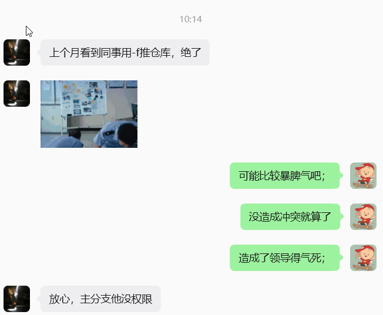

我们需要知道文件夹，暂存区，本地仓库，远程仓库；

### 拉取仓库

输入 git clone https://gitee.com/WTY2002/chat-room.git就可以将远程仓库拉到我们的本地

> `git clone` 会自动创建一个名为 `origin` 的远程别名，并默认切换到远程仓库的默认分支（通常是 `master` 或 `main`）。

### 本地仓库关联远程仓库：

```git
git remote add origin https://gitee.com/你的用户名/仓库名.git
```

具体来说，`git remote add origin ` 做的事情是：把远程仓库的地址写入本地仓库的配置文件 `.git/config` 里，给它起个别名叫 `origin`。你可以打开 `.git/config` 看看，大概长这样：

```
[remote "origin"]
    url = https://gitee.com/你的用户名/仓库名.git
    fetch = +refs/heads/*:refs/remotes/origin/*
```

所以它既不是暂存区（staging area / index），也不是文件夹本身：

- **暂存区**是 `.git/index`，只管"哪些文件改动准备提交"，跟远程地址没有任何关系。
- **文件夹**（工作区）是你看到的文件和目录，Git 远程配置也不存在那里。
- **本地仓库**（`.git/`）才是所有元数据、历史、配置、远程关联的存放地。

简单记：`git remote add` = 给本地仓库配一个"远程搭档"的地址和名字。

### 删除已关联的远程仓库 

```
git remote remove origin 
```

其实这就是解绑，他只是把叫 `origin` 的远程地址记录，不会影响远程仓库上的任何东西，也不会动你的代码和历史。就像你把通讯录里某个联系人的电话删了，对方不会有任何感知。之后想用还可以重新 `git remote add` 加回来。 

### 常见指令

#### 查看类

```bash
# 查看已关联的远程仓库
git remote -v
  
# 查看文件状态（红=未暂存，绿=已暂存）
git status

# 确认当前分支（本地仓库）
git branch


#如果想看远程分支，可用：
git branch -r

例如可能会看到：
origin/master
origin/arch-server
origin/arch-server-amaidou
```


#### 操作类

```

# 把当前目录所有变更加入暂存区（. 代表当前目录）
git add .
 
# 提交到本地仓库（-m 后是提交信息，必须写清楚做了什么）
git commit -m "新增/修改：xxx功能"
 
# 拉取远程仓库最新代码（避免冲突）
git pull origin master
 
# 推送到远程仓库（第一次推送需要 -u 关联分支）
git push -u origin master
 
# 后续推送（已关联分支后）
git push
```

### 一个小趣文



正常人都会先 `git pull --rebase` 再 push，直接 `-f` 强推确实让人血压飙升。 

### 关于拉取pull

 **`git pull` = 把远程仓库的最新代码拉到本地，并合并到你当前的分支。** 

它其实是两个操作的合体：

```
git pull = git fetch + git merge
```

- **git fetch**：从远程仓库下载最新数据到本地（只下载，不动你的代码）
- **git merge**：把下载来的远程分支合并到你当前工作分支

 什么时候需要 git pull 

| 场景               | 说明                                          |
| ------------------ | --------------------------------------------- |
| 开始一天的工作前   | 拉取团队最新代码，避免在过时的基础上开发      |
| push 之前          | 远程有你不知道的新提交时，必须先 pull 再 push |
| 同事更新了共享分支 | 保持同步                                      |

### 关于推送push

什么时候 push 会失败

最常见的报错：

```
! [rejected]        main -> main (fetch first)
error: failed to push some refs to 'origin'
hint: Updates were rejected because the remote contains work that you do
hint: not have locally.
```

 这正是上面同事遇到的场景。正确的处理顺序是： 

```
# 1. 先拉下来合并
git pull origin main

# 2. 有冲突就解决冲突，然后 commit

# 3. 再 push
git push origin main
```

相关链接，在我个人博客里：

git 常见命令：https://blog.csdn.net/weixin_54946088/article/details/157059951

git的使用：https://blog.csdn.net/weixin_54946088/article/details/153915362

git的介绍：https://blog.csdn.net/weixin_54946088/article/details/138465313
